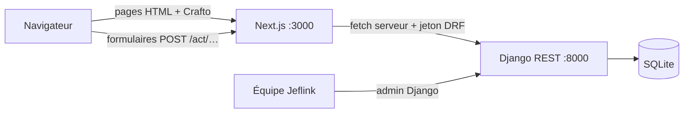

# Jeflink — Architecture de la démo

Objectif : une démo locale qui montre le parcours complet, lancée en deux commandes, lisible en une après-midi. L'architecture cible précédente est au tag `archive/avant-simplification`.

- **Web (Next.js)** : pages rendues côté serveur. Le jeton DRF est stocké dans un cookie httpOnly posé par les route handlers `src/app/act/*` ; le navigateur ne parle jamais directement à Django.
- **API (Django + DRF)** : trois apps, `accounts`, `catalog`, `jobs`. Règles métier dans `jobs/services.py`. Documentation OpenAPI sur `/api/docs/`.
- **Back-office** : l'admin Django (vérifier un pro, gérer métiers et quartiers, lire les messages de contact). Métiers et quartiers sont des données, jamais des listes en dur dans le code.

## Parcours

1. Le client s'inscrit (email + mot de passe) et publie une demande : métier, quartier, description, repère, date.
2. Les pros **vérifiés** de ce métier (et de ce quartier s'ils en ont choisi) la voient et envoient un devis en F CFA ; 3 devis au plus.
3. Le client choisit un devis : la demande passe « Pro réservé », les autres devis « Non retenu », chacun voit le numéro de l'autre.
4. Le client ou le pro marque la mission terminée ; le client laisse un avis (1 à 5).

Chaque étape est journalisée (`RequestEvent`) et affichée comme historique.

## Endpoints

| Méthode  | Chemin                                                                                             | Accès              |
| -------- | -------------------------------------------------------------------------------------------------- | ------------------ |
| POST     | `/api/auth/register/`, `/api/auth/login/`                                                          | public             |
| POST     | `/api/auth/logout/` · GET `/api/auth/me/`                                                          | connecté           |
| POST     | `/api/auth/contact/`                                                                               | public             |
| GET      | `/api/trades/`, `/api/trades/{slug}/`, `/api/zones/`, `/api/pros/`, `/api/reviews/`, `/api/stats/` | public             |
| GET/POST | `/api/requests/` (`?scope=open                                                                     | mine` pour un pro) | connecté |
| POST     | `/api/requests/{id}/quotes                                                                         | accept             | complete | cancel | review/` | selon le rôle |

## Après la démo

À traiter seulement quand on prépare une mise en ligne :

- Postgres à la place de SQLite ; `DJANGO_SECRET_KEY`, `DJANGO_DEBUG=0`, `ALLOWED_HOSTS` en production ; HTTPS.
- Limites de débit sur la connexion, l'inscription et le contact ; vérification de l'email.
- Connexion OTP par téléphone (app mobile), notifications (SMS / WhatsApp) quand un devis arrive.
- Paiement (mobile money) et commission ; photos avant/après ; litiges.
- Wolof ; pagination des listes ; images optimisées et JS allégé (voir `docs/DESIGN.md › À peaufiner`).
