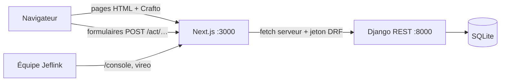

# Jeflink — Architecture de la démo

Objectif : une démo locale qui montre le parcours complet, lancée en deux commandes, lisible en une après-midi. L'architecture cible précédente est au tag `archive/avant-simplification`.

- **Web (Next.js)** : deux groupes de routes, chacun avec son layout racine. `(site)` = site public et espace client/pro (Crafto) ; `(console)` = console d'administration (vireo habillé Crafto). Pages rendues côté serveur. Le jeton DRF est stocké dans un cookie httpOnly posé par les route handlers `src/app/act/*` ; le navigateur ne parle jamais directement à Django.
- **API (Django + DRF)** : quatre apps, `accounts`, `catalog`, `jobs`, `console`. Règles métier dans `jobs/services.py`. Documentation OpenAPI sur `/api/docs/`.
- **Console** (`/console`, comptes `is_staff`) : pilotage de la plateforme, construite par lots (voir plus bas). L'admin Django reste disponible pour la maintenance. Métiers et quartiers sont des données, jamais des listes en dur dans le code.

## Parcours

1. Le client s'inscrit (email + mot de passe) et publie une demande : métier, quartier, description, repère, date. Il peut se faire aider par **Jef** (voir plus bas) : Jef pose deux ou trois questions, remplit le formulaire et joint une fiche pour le pro.
2. Les pros **vérifiés** de ce métier (et de ce quartier s'ils en ont choisi) la voient et envoient un devis en F CFA ; 3 devis au plus.
3. Le client choisit un devis, avec un code promo s'il en a un : la demande passe « Pro réservé », les autres devis « Non retenu », chacun voit le numéro de l'autre. Les montants de la mission sont figés à ce moment (voir « Argent »).
4. Le client ou le pro marque la mission terminée ; le client laisse un avis (1 à 5).
5. En cas de souci sur une mission réservée ou terminée, le client ou le pro **signale un problème** : un litige s'ouvre, l'équipe le traite dans la console et sa décision s'affiche dans la demande.

Chaque étape est journalisée (`RequestEvent`) et affichée comme historique.

## Endpoints

| Méthode  | Chemin                                                                                                                                                                                           | Accès                                                    |
| -------- | ------------------------------------------------------------------------------------------------------------------------------------------------------------------------------------------------ | -------------------------------------------------------- |
| POST     | `/api/auth/register/`, `/api/auth/login/`                                                                                                                                                        | public                                                   |
| POST     | `/api/auth/logout/` · GET `/api/auth/me/`                                                                                                                                                        | connecté                                                 |
| POST     | `/api/auth/contact/`                                                                                                                                                                             | public                                                   |
| GET      | `/api/trades/`, `/api/trades/{slug}/`, `/api/zones/`, `/api/pros/`, `/api/reviews/`, `/api/stats/`, `/api/site/` (réglages publics), `/api/campaigns/?placement=` (bandeaux en cours)            | public                                                   |
| GET/POST | `/api/requests/` (`?scope=open` ou `?scope=mine` pour un pro)                                                                                                                                    | connecté                                                 |
| POST     | `/api/requests/{id}/` + `quotes/`, `accept/`, `complete/`, `cancel/`, `review/`                                                                                                                  | selon le rôle                                            |
| POST     | `/api/jef/` (texte du client → métier probable et questions), `/api/jef/{id}/brief/` (réponses → demande et fiche du pro)                                                                        | client connecté (20 échanges par 24 h)                   |
| POST     | `/api/requests/{id}/report/` (signaler un problème)                                                                                                                                              | client ou pro de la mission                              |
| GET      | `/api/console/overview/?days=7·30·90`, `/api/console/badges/`                                                                                                                                    | équipe (`is_staff`)                                      |
| GET/POST | `/api/console/{requests,disputes,pros,clients,reviews,messages,audit}/` + actions (`cancel`, `note`, `verify`, `reject`, `suspend`, `reactivate`, `hide`, `show`, `handle`, `reopen`, `status`…) | équipe (`is_staff`), selon le rôle, actions journalisées |
| GET/POST | `/api/console/{coupons,campaigns}/` (+ `{id}/update/`), `commissions/`, `transactions/` (+ `export/` CSV), `balances/` (+ `{id}/settle/`), `reports/` (+ `export/`)                              | Marketing ou Finance selon la rubrique                   |
| GET      | `/api/console/jef/` (échanges, indicateurs, état : clé présente ou non, jamais sa valeur)                                                                                                        | Opérations                                               |
| GET/POST | `/api/console/{trades,zones,team}/` (+ `{id}/update/`, `role`, `deactivate`…), `/api/console/settings/`                                                                                          | équipe, selon le rôle                                    |

## Console d'administration

Décidée le 2026-10-12. Le front de la console fait grandir l'API : chaque rubrique arrive avec ses endpoints `/api/console/…`, réservés à l'équipe.

| Lot | Contenu                                                                                                                                                | État |
| --- | ------------------------------------------------------------------------------------------------------------------------------------------------------ | ---- |
| 0   | Fondations (vireo habillé Crafto, accès équipe, recherche Ctrl K, clair/sombre), tableau de bord branché sur les vraies données                        | fait |
| 1   | Demandes, litiges, pros (file de vérification, suspension), clients, avis (modération), messages de contact, journal d'audit                           | fait |
| 2   | Métiers, quartiers, réglages de la plateforme, équipe et rôles (Opérations, Marketing, Finance)                                                        | fait |
| 3   | Finances (commission par métier, transactions, soldes des pros) et marketing (codes promo financés par Jeflink, campagnes), rapports                   | fait |
| 4   | « Jef », l'IA d'assistance à la réservation : aide le client à décrire son souci, transmet une fiche claire au pro ; réglages et suivi dans la console | fait |

**Argent** (F CFA entiers, paiement sur place pour la démo) : quand le client choisit un devis, la mission fige `price` (le devis), `discount` (remise du code promo, financée par Jeflink), `commission_rate` (taux du métier, sinon taux par défaut) et `commission`. Le client paie au pro `price - discount` ; le pro doit à Jeflink `commission - discount` (si c'est négatif, Jeflink doit la différence au pro). Les soldes des pros cumulent ce dû sur les missions terminées, corrigé des règlements enregistrés par la Finance. Règles des codes promo (dates, montant minimum, plafond, utilisations, première mission, métiers et quartiers) dans `jobs.services.check_coupon` ; une réservation consomme le code même si le client l'annule ensuite, seule une annulation par l'équipe le libère. Pourcentages arrondis au franc sans float (`percent_of`). La commission n'est visible que du pro et des rôles Finance.

**Jef** (app `jeflink/jef`) : le client raconte son souci avec ses mots ; Jef propose le métier, pose trois questions au plus (avec des choix courts), puis rédige le titre, la description, l'urgence, des conseils pour le client et une fiche pour le pro (résumé, faits, matériel à prévoir). Deux appels à Claude (`ai.py`, SDK `anthropic`, réponses en JSON imposé, effort bas, repli serveur sur refus) ; sans clé `ANTHROPIC_API_KEY` dans `apps/api/.env`, ou si l'appel échoue, Jef passe en **mode guidé** (`guide.py` : questions fixes par métier, fiche composée) et le client n'est jamais bloqué. Sécurité d'abord : en cas de danger (feu, étincelles, gaz, inondation), des gestes sûrs s'affichent avant les questions ; les questions servent au diagnostic (« les voisins ont-ils du courant ? ») puis au devis (appareil, étage, matériel). Le texte du client est encadré comme donnée dans le prompt ; un numéro ou un email dans le texte est refusé, et toute coordonnée ou lien dans la fiche est masqué ; les réponses du modèle sont tronquées avant stockage (`JefSession`), une seule fiche par échange (un appel à l'IA). La fiche suit la demande (`ServiceRequest.jef_session`) : le client en reçoit les conseils, les pros la fiche (résumé, faits, matériel suggéré « à confirmer sur place ») ; limites : 20 échanges par client et 300 échanges en IA par 24 h (au-delà, mode guidé) ; l'équipe relit les échanges dans la console (Opérations) et peut retirer Jef du site (Réglages). Modèle : `AI_MODEL_DEFAULT` du `.env`, sinon `claude-opus-5-5`.

**Rôles de l'équipe** (`console/permissions.py`, contrôlés par l'API, menu filtré côté web) : Super admin = tout ; Opérations = demandes, litiges, pros, clients, avis, messages, journal, catalogue ; Marketing = catalogue et marketing ; Finance = finances. Le tableau de bord est ouvert à tous.

**Réglages** (`PlatformSettings`, super admin) : devis maximum par demande, délai de l'alerte « sans devis », pause des nouvelles demandes avec message, WhatsApp et email du support, Jef proposé ou non (lus par le site via `/api/site/`).

Les rubriques pas encore construites figurent déjà dans le menu (`src/console/nav.ts`) avec leur numéro de lot.

## Après la démo

À traiter seulement quand on prépare une mise en ligne :

- Postgres à la place de SQLite ; `DJANGO_SECRET_KEY`, `DJANGO_DEBUG=0`, `ALLOWED_HOSTS` en production ; HTTPS.
- Limites de débit sur la connexion, l'inscription et le contact ; vérification de l'email.
- Connexion OTP par téléphone (app mobile), notifications (SMS / WhatsApp) quand un devis arrive.
- Paiement (mobile money) et commission ; photos avant/après ; litiges.
- Wolof ; pagination des listes ; images optimisées et JS allégé (voir `docs/DESIGN.md › À peaufiner`).
- `seed_demo` refuse de tourner si `DJANGO_DEBUG=0` : le compte `admin@jeflink.local` (superuser, mot de passe de démo public) ouvre toute la console. Les numéros du seed (`+22177…`) ont un format réel : aucun SMS ni WhatsApp vers eux.
- Polices de la console servies en local plutôt que par Google Fonts.
- Comptes de l'équipe : double authentification, sessions courtes, changement obligatoire du mot de passe provisoire à la première connexion ; rôles distincts (lot 2). Journal d'audit en ajout seul au niveau de la base, avec une durée de conservation (il contient des noms).
- Limites de débit sur « signaler un problème » et sur les actions de la console ; recherche de la console (téléphone, email) hors des URL journalisées.
- Messages de retour de la console (`?ok=`, `?erreur=`) passés par des codes plutôt qu'en texte libre.
- Codes promo (lot 3) : verrous `select_for_update` effectifs seulement sous Postgres (sous SQLite, deux réservations simultanées peuvent échouer en « database is locked ») ; limite de débit sur les essais de code (les motifs de refus distinguent un code programmé d'un code inconnu) ; lutte contre les comptes multiples et les faux clients créés par un pro pour toucher BIENVENUE (code lié à un téléphone vérifié, remise remboursée seulement à la fin de la mission, alerte si client et pro partagent un téléphone).
- Annulation d'une mission réservée : aujourd'hui le client peut annuler à tout moment avant la fin, ce qui sort la mission des soldes (commission et remise). À trancher : annulation réservée à l'équipe, ou avec l'accord du pro. Le code promo, lui, reste consommé (seule l'équipe le libère).
- Jef : suivi du coût (jetons par échange) et alerte de crédit, limite de débit par adresse en plus des limites par compte et globale (comptage non atomique), questions conditionnelles (selon la réponse précédente) et mots wolof validés par des locuteurs, envoi de photos, durée de conservation des textes des clients (données personnelles possibles malgré la consigne), relecture des échanges pour améliorer les questions, wolof.
- Remboursement des remises aux pros : délai et moyen à fixer (aujourd'hui « l'équipe vous contacte après la mission », saisie à la main dans Soldes) ; aperçu du prix final avant de choisir un devis (« Vérifier mon code »).
